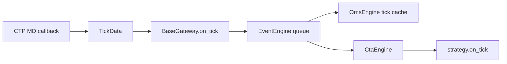

# 行情与事件链

CTP 的 MD 与 TD 是两个会话。`CtpMdApi.onRspUserLogin` 在成功回报中恢复订阅；`onRtnDepthMarketData` 检查时间与合约缓存，再构造 `TickData`。对大商所的 ActionDay，官方网关使用当前自然日作补正。这里的日期处理属于适配层，研究或执行代码仍需区分交易日、自然日和行情可用时间。[^md]

`TickData` 保存盘口、成交量、时间和合约标识。`OrderRequest` 是待发送的指令；`OrderData` 是订单回报；`TradeData` 是一次成交；`PositionData` 是持仓回报。`vt_symbol` 由合约与交易所组成，`vt_orderid` 加入网关命名空间。这些字段使不同柜台数据统一，但它们本身不提供跨进程的策略意图记录。[^objects]

`BaseGateway.on_tick` 发出普通 Tick 事件和合约专属事件。`EventEngine` 有一个队列处理线程和一个定时事件线程；注册处理器在分发线程中依次调用。耗时处理器会延迟其他事件。`_run` 只捕获队列空异常，不能据此推断任何用户处理器异常都已被隔离。[^gateway][^event]

`OmsEngine` 用字典保存最新的行情、订单、成交、持仓、资金和合约；订单更新同时维护活动委托集合并通知开平转换器。它提供进程内缓存，重启后的真实持仓仍要向柜台查询。持仓或资金为空的初始字典不能解释为柜台已确认空仓或零资金。[^oms]

这条链有两种队列：CTP 包装层的 C++ 回调任务队列，以及 VeighNa 的 Python 事件队列。它们承担不同层次的分发，不能把 SDK 回调到达时间直接当作策略处理完成时间。[包装层说明](vnpy-ctp.md)

[返回目录](index.md) · [继续阅读委托链](orders-and-reconciliation.md)

## 参考

[^md]: VeighNa, [ctp_gateway.py，CtpMdApi](https://github.com/vnpy/vnpy_ctp/blob/1be9bfb5292208e5c258cc769c90be4abe83f9a9/vnpy_ctp/gateway/ctp_gateway.py#L254)，尤其 onRspUserLogin 与 onRtnDepthMarketData。
[^objects]: VeighNa, [object.py](https://github.com/vnpy/vnpy/blob/c6e231caf32b7fc97e6459817fff66458cf7e7c4/vnpy/trader/object.py#L30)，TickData、OrderData、TradeData、PositionData、OrderRequest。
[^gateway]: VeighNa, [gateway.py，on_event/on_tick](https://github.com/vnpy/vnpy/blob/c6e231caf32b7fc97e6459817fff66458cf7e7c4/vnpy/trader/gateway.py#L92)。
[^event]: VeighNa, [event/engine.py，EventEngine](https://github.com/vnpy/vnpy/blob/c6e231caf32b7fc97e6459817fff66458cf7e7c4/vnpy/event/engine.py#L35)。
[^oms]: VeighNa, [trader/engine.py，OmsEngine](https://github.com/vnpy/vnpy/blob/c6e231caf32b7fc97e6459817fff66458cf7e7c4/vnpy/trader/engine.py#L375)。
