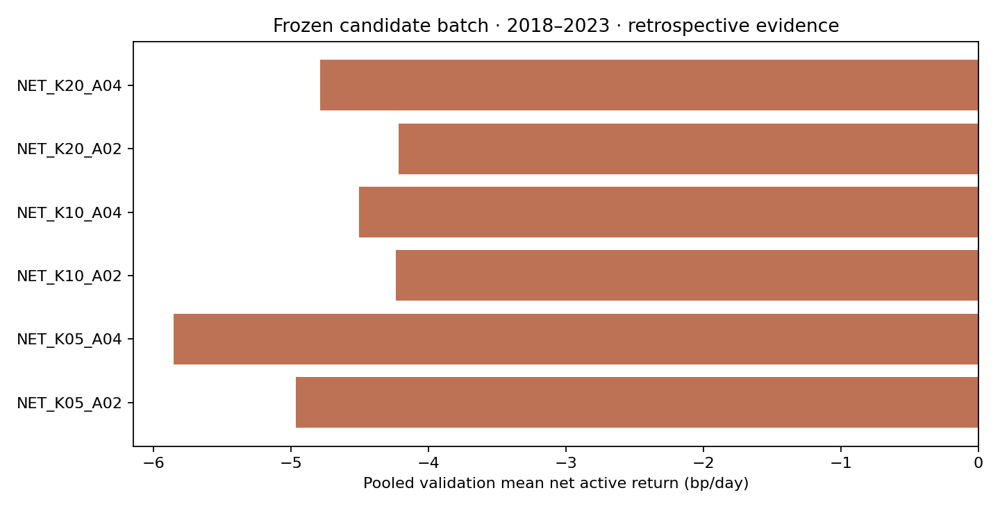
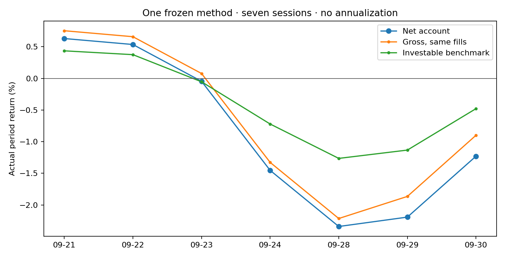

# 第二讲作业

[第二讲源码学习 Wiki](../../docs/veighna/index.md) · [作业首页](../../README.md)

## A 股跨股票领先—滞后网络

用历史收益估计股票之间的方向性联系，再将领先股票的近期收益加权为目标股票打分。研究采用 `NET_K20_A02`：20 个领先股票、指数平滑系数 0.2，每五个交易日调仓。

[完整报告](package/SUBMISSION.md) · [精确公式与账户规则](package/research/method.md) · [源码](package/src/factorlab/features.py) · [复现说明](package/REPRODUCE.md) · [课程提交正文](COURSE_COMMENT.md)

### 实测方案

| 方案 | 领先股票数 / 平滑系数 | 构造说明 | 验证期净主动收益，基点/日 |
|---|---|---|---:|
| `NET_K05_A02` | 5 / 0.2 | 5 个领先股票；较长记忆 | −4.965 |
| `NET_K05_A04` | 5 / 0.4 | 5 个领先股票；更重近期 | −5.856 |
| `NET_K10_A02` | 10 / 0.2 | 10 个领先股票；较长记忆 | −4.240 |
| `NET_K10_A04` | 10 / 0.4 | 10 个领先股票；更重近期 | −4.506 |
| `NET_K20_A02`（采用） | 20 / 0.2 | 20 个领先股票；较长记忆 | −4.218 |
| `NET_K20_A04` | 20 / 0.4 | 20 个领先股票；更重近期 | −4.788 |

较小的平滑系数保留较长记忆，较大的平滑系数更重视近期变化。六个方案使用相同方向、调仓周期、股票池和执行规则。选定方案的验证期平均净主动收益最高，按预定备选规则采用；六个方案均未达到预设验证门槛。

### 期间结果

| 指标 | 记录 |
|---|---:|
| 开发期 | 2008–2017 |
| 验证期 | 2018–2019、2020–2021、2022–2023 |
| 选定方案验证日期数 | 1,457 |
| 验证期平均净主动收益 | −4.218 基点/日 |
| HAC 95% 置信区间 | [−6.286, −2.149] 基点/日 |
| 最终评价日期 | 2026 年 9 月 21–24、28–30 日 |
| 最终账户净收益 | −1.230% |
| 同股票池基准净收益 | −0.479% |
| 相对基准复合收益 | −0.755% |
| 最终成熟 IC 日期数 | 2 |

账户从人民币 100 万元现金开始，采用历史成分、次日执行、整手交易、仓位和成交参与率限制，并计算交易成本。基准采用相同股票池和一致账户规则。最终期间共七个交易日，按实际期间报告；历史区间及部分 9 月日期已有研究暴露。

### 代码和证据

- `package/src/factorlab/`：数据、特征、标签、账户、统计和报告模块。
- `package/configs/`：六个方案及原研究的协议、费用和冻结记录。
- `package/results/`：统一指标文件、逐日汇总、对照及诊断结果。
- `package/research/`：实施方法、实际对照、数据审计、实验记录及修正说明。
- `package/tests/`：25 项研究测试和 8 项发布副本完整性检查。
- [下载研究包](literature-factor-20261009.zip) · [SHA256](literature-factor-20261009.zip.sha256)。

原研究已完成隔离环境历史复现及 63 份账户账本算术核验。原始数据及第三方文件不随包提供。数值结果和科学计算模块与原研究保持一致；文档、报告生成和包校验的整理记录在 `package/release/publication_derivation.json`。

### 来源与复核

方法中的方向性统计量参考 [Bennett、Cucuringu 和 Reinert（2022）](https://arxiv.org/abs/2201.08283)。实际执行的比较公式见[对照说明](package/research/tested_controls.md)。

历史停牌标签修正、分红数据补充及一次最终组合评价的边界见[修正记录](package/research/protocol_deviations.md)。当前发布状态见 [RELEASE_STATUS.json](package/RELEASE_STATUS.json)。
