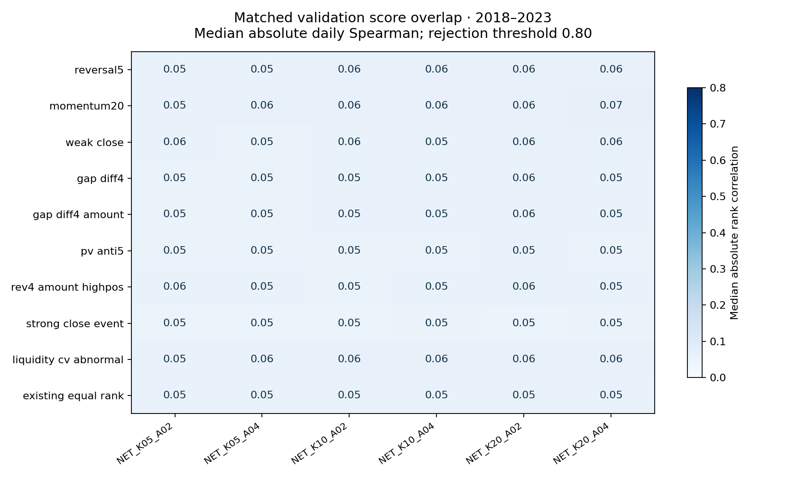

# Cross-stock lead–lag: a bounded retrospective A-share study

Research outcome: `NO_FACTOR_PASSED`. Method selected: `NET_K20_A02`. Validation qualified: `false`.

The research asks whether past directed return links add economic value beyond inspected own-stock technical signals under a cash-constrained long-only account. Previously viewed 2008–2017 dates support development diagnostics; 2018–2019,2020–2021 and2022–2023 form the frozen validation folds. The primary result uses actual simulated net account returns, not overlapping forward-label spreads.

## Complete candidate comparison

| Candidate | Evaluable | Mean net active, bp/day | Holm p | Qualified | Selected |
|---|---|---:|---:|---|---|
| NET_K05_A02 | True | -4.965 | 1.000 | False | False |
| NET_K05_A04 | True | -5.856 | 1.000 | False | False |
| NET_K10_A02 | True | -4.240 | 1.000 | False | False |
| NET_K10_A04 | True | -4.506 | 1.000 | False | False |
| NET_K20_A02 | True | -4.218 | 1.000 | False | True |
| NET_K20_A04 | True | -4.788 | 1.000 | False | False |

For the selected method, pooled validation mean net active return was -4.218 bp/day over 1457 dates. The lag 10 HAC 95% interval was [-6.286, -2.149] bp/day; unadjusted one-sided p=1.000, Holm over 18 slots p=1.000. Positive folds: 0/3. Mean daily turnover was 22.534%.

The mean matched daily RankIC was 0.008. The paired mean economic increment over the frozen existing-signal account was 0.177 bp/day; its 95% interval is retained in the metrics artifact. Sector checks use dated prior-year classifications. Existing-signal projection coefficients are fitted only in 2008–2017; validation labels never fit a transform.

| Validation fold | Sessions | Net account % | Benchmark % | Mean active bp/day | Max drawdown % |
|---|---:|---:|---:|---:|---:|
| 2018-01-02–2019-12-31 | 487 | -18.727 | -3.783 | -3.269 | -37.989 |
| 2020-01-02–2021-12-31 | 486 | -3.549 | 15.700 | -3.557 | -20.011 |
| 2022-01-04–2023-12-29 | 484 | -32.170 | -9.037 | -5.835 | -34.421 |

Recorded qualification criteria not met: Holm_5pct, two_positive_folds, incremental_account_HAC_lower_positive.

Training-fitted residual-score RankIC: 0.008; within-sector RankIC: 0.010; mean historical sector coverage: 100.000%.

| Frozen historical diagnostic | Mean active bp/day | HAC 95% interval, bp/day |
|---|---:|---|
| friction_2x | -5.783 | -7.844 to -3.723 |
| friction_3x | -7.564 | -9.626 to -5.503 |
| delay_plus_one | -4.702 | -6.763 to -2.642 |
| capacity_10m | -4.057 | -5.827 to -2.288 |
| transfer_higher_liquidity_half | -1.800 | -4.658 to 1.057 |
| ablation_reversal5 | -4.678 | -7.574 to -1.783 |
| ablation_momentum20 | -3.261 | -6.124 to -0.397 |
| ablation_existing_equal_rank | -4.395 | -6.956 to -1.834 |
| ablation_permuted_leader_graph | -5.821 | -7.679 to -3.963 |

## One frozen final check

The unchanged selected method was evaluated on September 21–24 and 28–30, 2026 (seven sessions), starting with CNY 1 million cash. Net account return: **-1.230%**; benchmark: **-0.479%**; relative compounded return: **-0.755%**. Final cash: CNY59971.56; remaining marked positions: CNY927726.00 in 49 names. No October 8 outcomes or holiday observations are used.

| Diagnostic | Net account % | Benchmark % | Relative % | Fees CNY | Failed orders |
|---|---:|---:|---:|---:|---:|
| base | -1.230 | -0.479 | -0.755 | 1004.60 | 13 |
| friction_2x | -1.377 | -0.600 | -0.782 | 1674.70 | 13 |
| friction_3x | -1.545 | -0.727 | -0.824 | 2344.85 | 13 |
| delay_plus_one | -2.278 | -1.034 | -1.256 | 990.98 | 14 |
| capacity_10m | -1.437 | -1.429 | -0.008 | 10750.16 | 4 |
| transfer_higher_liquidity_half | -2.339 | -1.903 | -0.444 | 1120.26 | 3 |

Mature daily IC dates: 2. Dependence-aware inference: Too few dates for declared HAC inference. Annualized final headlines are deliberately unavailable.

## Method, intuition and implementation

# Method and accounting specification

This is a cross-stock, price-based lead–lag hypothesis. A stock may respond after other stocks that have historically tended to move first. The mechanism could reflect gradual information transmission, but a return correlation cannot identify that cause. Shared news, market/style exposure, asynchronous trading and noise are competing explanations.

For stock i and market session t, let r(i,t) be the log return of its adjusted close. A missing or suspended session, including a missing adjacent endpoint, gives an unavailable return, not zero. At the first session of January, March, May, July, September and November, estimate on the expanding history starting 2008-01-01 and ending at the previous close:

`C(i,j) = corr(r(i,u-1), r(j,u))`, using at least 200 matched calendar pairs.

`D(i,j) = max(C(i,j)-C(j,i), 0)` when C(i,j)>0, otherwise zero. Set D(i,i)=0. Only members eligible at the last training close can be graph nodes. Retain each target j's K strongest incoming positive edges, keeping complete boundary ties. Divide each retained column by its sum to obtain W(i,j).

`E(i,t) = alpha*r(i,t) + (1-alpha)*E(i,t-1)` is the recursive exponentially weighted return. The actual missing-observation weighting is pandas EWM with `adjust=False, ignore_na=False, min_periods=5`, followed by masking unavailable current returns. This precise convention is part of the frozen definition.

`S(j,t) = sum_available_i W(i,j)*E(i,t) / sum_available_i W(i,j)`.

A score exists only when at least 80% of the original leader weight is currently observed and eligible. Current target eligibility must hold. K is 5, 10 or 20 and alpha is 0.2 or 0.4, giving exactly six candidates. The direction is fixed positive; the holding/rebalance interval is fixed at five exchange sessions. There is no sign, normalization, horizon or hidden model grid. Expanding refits use earlier returns, never a future label. No supervised coefficients are trained.

An invented example, unrelated to market evidence: two retained leaders have weights 0.6 and 0.4 and smoothed log returns +0.010 and −0.005. The target score is +0.004. That is a weighted summary of other stocks' past movements, not a forecast promising a 0.4% gain. Its rank across currently eligible targets determines portfolio preference.

The implementation is `features.graph_weights` and `features.network_score`; candidate settings are in `configs/candidate_registry.json`. It adapts the lag-one directed statistic in Bennett et al. (2022), pp4–6. The expanding graph and direct peer aggregation are explicitly this project's hypotheses.

## Universe, orders and account

Use the recovered, dated CSI300 membership intervals, not all 819 cached symbols at once. Restrict to Shanghai and Shenzhen main-board A shares; require 252 observed prices, 20-session median traded amount of at least CNY20m, no signal-date risk-warning flag, a traded signal-day bar and at least 200 eligible stocks. A missing current flag is ineligible where historical raw flags exist. The cache-only development ordering diagnostic cannot establish a pre-2017 executable account. Delisted symbols remain in source history; a missing mark is carried explicitly, never silently assigned a zero loss.

The signal is complete only after the close. At each fifth session, beginning with the first session of each validation fold/final interval, the prior session's score selects the top fifth. Include complete score-cutoff ties; fewer than five unique scores or fewer than 200 scored stocks creates no new target. The equal-weight same-universe benchmark follows the same dates, account, fees and fill rules. Both start in cash at each fold; no hidden inherited positions or synthetic short leg.

Target quantities use known pre-opening references and the prior marked account, not the current opening or closing price. Model sells followed by buys at the opening-price approximation, with adverse cent rounding, 5bp slippage and a 1% participation cap on both lagged ADV and realized daily share volume. The latter can restrict fills, never historical eligibility. Completed sells make cash available for subsequent modeled buys. Daily bars cannot establish the timing/queue depth of such sequential opening-price fills; this is a disclosed execution approximation, tested under additional friction and delay. Orders blocked by suspension, missing bars, cash, lots or opening limit boundaries stay in the failure ledger.

Capital is CNY 1 million; the stress account uses CNY 10 million. Purchases are in 100-share lots and capped at 5% of account equity. Sales respect existing settled shares (T+1); complete odd-lot balances may be sold. No borrowing, shorting or cash yield. The modeled commission is 3bp per side with CNY5 minimum, inclusive of exchange/broker handling but exclusive of transfer fees and stamp duty. Transfer fee is 0.002% per side before 2022-04-29 and 0.001% after; stamp duty is 0.1% on sells before 2023-08-28 and 0.05% after. Friction stresses multiply commission and slippage, not statutory charges. These are assumptions plus dated charges, not a broker quote.

Cash/bonus entitlements use shares held on the record-date close. Cash remains a receivable until its payment date; bonus shares cannot trade until listing. Floor fractional bonus-share entitlements conservatively. Reserve 20% of taxable cash and stock-dividend face value without claiming exact individual FIFO tax settlement; capital-reserve share transfers are not treated as taxable stock dividends. This is conservative for long-held cash dividends. It is separate from statutory transaction fees. Optional rights subscriptions are declined consistently: no free shares or invented rights proceeds; the raw-price dilution remains in wealth. Verified rights events and the two missing special cash dividends are documented in `data/supplementary_actions.json`.

Gross equity means the same actual modeled fills with cumulative transaction charges, slippage and dividend-tax provision added back. It is not a separately optimized frictionless account and does not reinvest fee savings. Net equity is cash plus marked shares plus receivables less unpaid provision. Report both definitions explicitly.

## Inference and novelty

The primary observation is a date-level daily net account return minus the investable benchmark's daily net return. Pool the three validation folds and use a one-sided positive-mean HAC test with lag 10; report two-sided 95% intervals and lag5/20 sensitivity. Apply Holm over eighteen reserved slots; twelve unused slots receive p=1. Thousands of stock observations do not create independent market histories.

Qualification requires valid accounting/data, defensible public-source distinctness, Holm p<=0.05, positive net active mean in at least two folds, and a positive economic increment over the frozen equal-rank existing-factor account with a positive HAC lower bound. Qualification additionally requires positive raw daily RankIC, positive training-fitted residual-score RankIC, at least 95% mean dated-industry coverage, positive count-weighted within-sector RankIC and at least three sectors with positive mean IC over 60 or more dates. Sector IC requires at least ten matched stocks. Annual industry snapshots are queried before the year; no current label is backfilled. Vendor archival revisions cannot be independently excluded. A median absolute matched-date Spearman correlation >=0.80 with a nearest existing-factor control fails the redundancy screen. Low correlation alone does not prove novelty. Matched tail overlap, own-stock controls and the incremental account comparison are retained.

Select the highest pooled mean net active return among qualified candidates. If none qualify, choose that same maximum among evaluable distinct candidates, even if every mean is negative. Exact ties use K complexity, lower turnover, then candidate ID. Selection and qualification are separate fields. No valid candidate means a blocked study, not a fabricated fallback.

## Seven-session evaluation boundary

After freezing exactly one method, independently acquire September 20–October7, 2026 and the history required by the expanding refit. The intended sessions are September 21–24 and 28–30. Orders on September 21 use September 18 scores and an already fitted graph; September's graph uses returns through August31. Finish valuation at September 30's close, retaining and reporting unrealized positions. Do not retrieve October 8 outcomes or treat holidays as observations.

Raw public prices reconstruct point-in-time normalized feature returns from `close/preclose`, masking suspensions and missing adjacent sessions. This avoids applying future adjustment levels; adjustment rounding differs slightly from the course cache and is checked on historical overlap. Raw prices, cash actions and shares, rather than normalized prices, drive the account. Only the finalist receives the final evaluation and fixed diagnostic stresses. A single-attempt marker and access log prohibit routine reruns or runner-up tests.

The final interval partly overlaps student research through September 23. It is independent acquisition, not demonstrably untouched data. Seven sessions support actual period returns, fills and mature labels; HAC intervals and annualized headlines are unavailable when sample size is inadequate. A fallback retains `NO_FACTOR_PASSED` even after a positive short check. A qualified method can at most be `PROMISING_NEEDS_NEW_DATA` or `INCONCLUSIVE`; never `STRONG_CANDIDATE` here.

## Frozen controls, transfer and interpretation

The existing-factor baseline equal-weights eight dense percentile signals: five-day reversal, 20-day momentum, weak close, four-day gap difference, amount-weighted gap, five-day price/volume anticorrelation, reversal × amount × recent price position, and abnormal-liquidity CV. The strong-close event is a separate sparse comparator. The formulas and source boundaries are in `research/tested_controls.md`. No undisclosed private formula is claimed to have been reproduced.

For the incremental ordering diagnostic only, regress the candidate percentile score on an intercept and the percentile scores of reversal5, momentum20, the equal-rank existing control, and liquidity CV using 2008–2017 observations. Freeze those coefficients for all validation dates. Regress no outcome and fit no coefficient in validation. Compare the residual score with the original forward label. Report within-industry RankIC separately, using ten-name minimum groups and count-weighted averages; this is a descriptive partition, not a fitted industry model or a tradable sector-neutral strategy.

Only after the primary choice, apply the selected method to the fixed 2×/3× commission/slippage, one-extra-session delay, CNY 10 million capital, and higher-liquidity-half transfer accounts. The transfer universe uses the signal-date median of lagged 20-session median amount and a prespecified 100-name breadth floor, with its own same-universe benchmark. Its account is not used for selection. Diagnostic ablations use reversal5, momentum20, the existing-control account, and a seed-20261009 permutation of graph leader identities at each refit; remove self-links and renormalize. Adjacent K/alpha choices are already counted among the six candidates, not extra hypotheses.

All historical account folds start in cash. The CNY 1 million equal-weight broad benchmark can have substantial cash drag from 100-share lots and expensive stocks; active return is therefore relative to that feasible account, not to the published CSI300 total-return index. No alternative benchmark can replace it after performance is seen.

Rules and evidence: [SSE trading rules, effective July 2026](https://www.sse.com.cn/lawandrules/sselawsrules2025/stocks/exchange/c/c_20260424_10816482.shtml), [historical SSE investor fee explanation](https://www.sse.com.cn/services/investors/questions/pay/c/c_20220421_5701222.shtml), [SSE stamp-duty reduction, 2023](https://english.sse.com.cn/news/newsrelease/c/5725967.shtml), [ChinaClear fee announcement reported by Xinhua, 2022](https://www.xinhuanet.com/2022-04/28/c_1128605983.htm), [tax authority dividend policy](https://www.chinatax.gov.cn/n810341/n810755/c1797427/content.html), and [official September/October 2026 calendar](https://www.sse.com.cn/disclosure/announcement/general/c/c_20260915_10832273.shtml). The ChinaClear issuer page was not recovered; the published agency report is explicitly secondary to that announcement. The 20% dividend provision is a model assumption; actual holding-period taxation differs.

Diagnostic forward labels require traded entry and exit endpoints. A suspended endpoint is unavailable even when the vendor stores a stale positive open. The market calendar is never compressed. Version 2 corrected this diagnostic mask after the first historical run; account execution and the primary selection rule were unchanged. See the retained invalidation record.

## Implementation reference

# Implementation reference

The implemented directed lag-one return statistic is adapted from Bennett, Cucuringu and Reinert (2022), [Lead–lag detection and network clustering for multivariate time series with an application to the US equity market](https://arxiv.org/abs/2201.08283), version 1, pages 4–6. The original source is credited for the dependence statistic. The implemented study uses the exact equations in `research/method.md` and the six registered variants in `configs/candidate_registry.json`.

The tested construction estimates positive lag-one directional dependence, retains incoming links, and combines leaders' exponentially smoothed log returns. Expanding refits and direct weighted aggregation are the adaptation evaluated here. The source PDF is not redistributed.

## Reproducibility and limitations

`results/metrics.json` is the sole validated input to this report and its summary plots. Unavailable fields remain null with reasons. The 18-slot registry, append-only experiment ledger, data fingerprints and exposure ledger are supplied. Original source files were preserved. Anonymous public downloads were supplemented with exchange rights-issue records and issuer special-dividend announcements; no student credentials were used.

Daily-bar fills, conservative dividend provisions, annual sector snapshots and unverified archival vendor revisions limit interpretation. Costs, cash drag, failed fills and lot constraints are economic outcomes, not reasons to replace the method. The September interval contains only seven sessions and overlaps earlier student study coverage through September 23. Independent download does not restore an untouched holdout. A new, adequately long, frozen future sample would be needed for a stronger claim; no future monitoring was scheduled.

Exact tested commands, exit codes, rights boundaries and package checks are recorded in [REPRODUCE.md](REPRODUCE.md) and [release/review_checklist.md](release/review_checklist.md). The archive excludes raw provider panels, licensed course cache, third-party source files and PDFs, and detailed price-bearing ledgers whose redistribution rights were not established. Full local private outputs remain available in the work directory.

Current distribution status is recorded in `RELEASE_STATUS.json`.

## Recorded integrity repairs

See [the repair record](research/protocol_deviations.md) for the historical label correction and final acquisition-gate recovery. The primary account results and method selection were unchanged by the historical correction. The final account was evaluated once after the data supplement.

## Gross/net accounting

The following rows use the recorded `results/metrics.json` without recomputing features, labels or portfolio outcomes.

| Period | Gross return, same fills % | Net return % | Mean daily turnover % | Net maximum drawdown % |
|---|---:|---:|---:|---:|
| 2018-01-02–2019-12-31 | 2.102 | -18.727 | 23.863 | -37.989 |
| 2020-01-02–2021-12-31 | 18.396 | -3.549 | 22.201 | -20.011 |
| 2022-01-04–2023-12-29 | -14.934 | -32.170 | 21.531 | -34.421 |
| 2026-09-21–2026-09-30 | -0.900 | -1.230 | 31.662 | -2.952 |

Gross return reverses recorded fees, adverse slippage and dividend-tax reserve for the same executed quantities; it is not a separately optimized frictionless portfolio. In the seven-session final interval, fees were CNY 1004.60, adverse slippage CNY 2209.00, and dividend-tax reserve CNY 92.54. Turnover is traded notional divided by the frozen account's pre-execution marked NAV after corporate actions. Final net active-mean confidence interval remains null: Too few dates for declared HAC inference. Historical HAC intervals and the actual tested sensitivity results appear above.

Metrics SHA-256: `7e359b00625178d5a9f7c7f6b54f72b5dd1c8485de2b4570b86c363e75df0426`.
